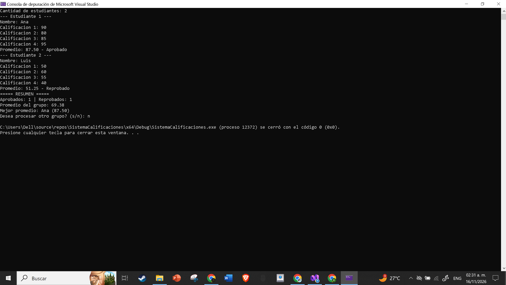
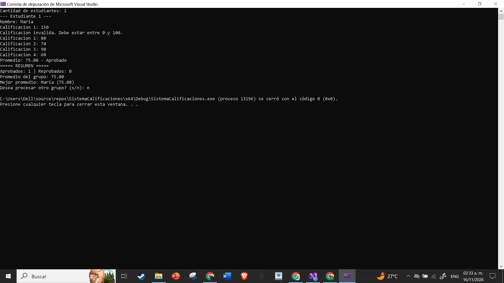
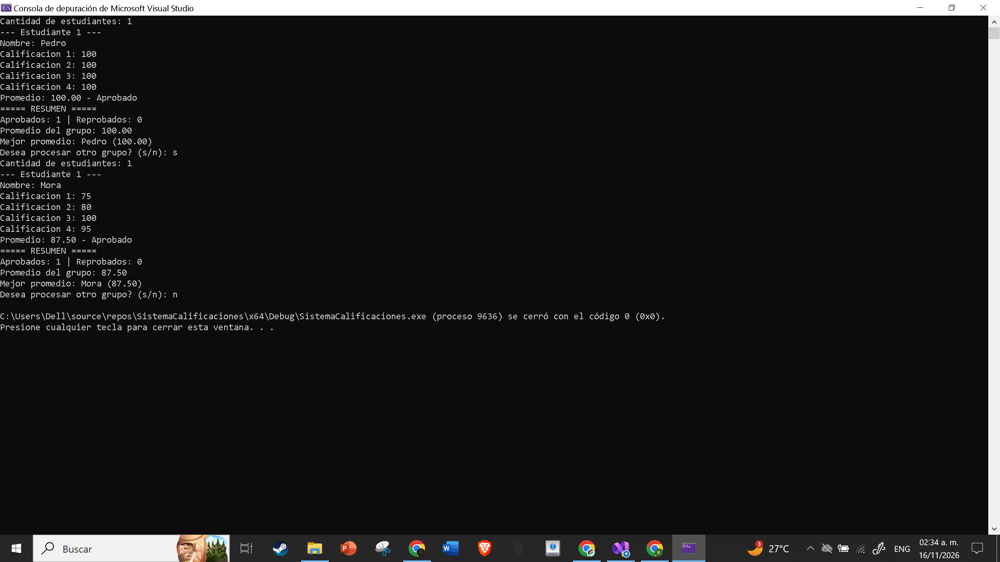

Sistema de control de calificaciones - La Nueva Escuela

Estudiante: Chrismairy Mora
Matrícula: 2024-3844
Asignatura: Lógica de Programación
Profesor: Gamalier Reyes del Carmen

Descripción del programa

Programa en C++ que registra las calificaciones de un grupo de estudiantes, calcula el promedio de cada uno, indica si está Aprobado o Reprobado, y al final muestra un resumen del grupo. Permite procesar otro grupo si el usuario lo desea.

Datos de entrada

- Cantidad de estudiantes (debe ser mayor que 0)
- Nombre de cada estudiante
- 4 calificaciones por estudiante (cada una entre 0 y 100)
- Respuesta s / n para procesar otro grupo

Proceso
1. Valida la cantidad de estudiantes.
2. Para cada estudiante pide nombre y 4 calificaciones, validando cada nota.
3. Calcula el promedio de cada estudiante con sumaNotas / 4.
4. Cuenta aprobados y reprobados, acumula los promedios y busca el mejor promedio.
5. Calcula el promedio general con sumaPromedios / cantidadEstudiantes.
6. Pregunta si desea procesar otro grupo y repite si responde s.

Salida
- Promedio de cada estudiante con Aprobado (70 o más) o Reprobado.
- Resumen: cantidad de aprobados y reprobados, promedio general, nombre y promedio del mejor estudiante.

Capturas de pantalla

Explicación de los bucles usados

for: Lo usé para recorrer estudiantes y para recorrer las 4 calificaciones, porque en esos casos ya sabía exactamente cuántas veces se iba a repetir.

do-while: Lo usé para validar la cantidad de estudiantes, para validar cada calificación y para repetir todo el programa con otro grupo, porque el bloque debe ejecutarse al menos una vez y luego repetir si la condición no se cumple.

while:Lo usé para validar que la respuesta a "¿Desea procesar otro grupo?" sea s o n, porque no sabía cuántas veces el usuario se iba a equivocar.